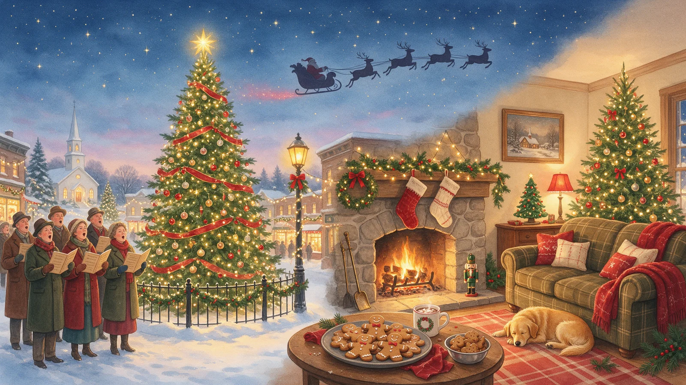
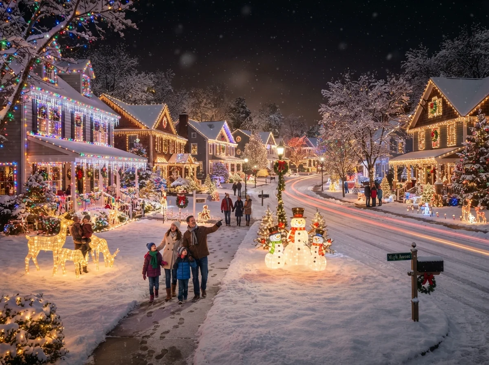
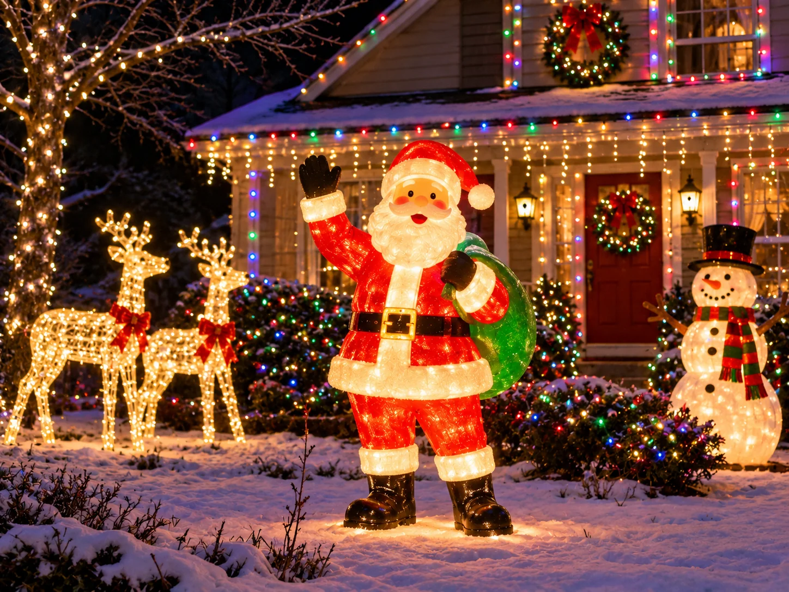

# Article 1: The Magic of the Holiday Season

*The sights, sounds, and atmosphere that make the holiday season special.*

For many Americans, Christmas is more than a single day on the calendar. It is an entire season filled with familiar sights, sounds, and traditions. Although Christmas Day falls on December 25, the holiday season usually begins around Thanksgiving in late November. By then, stores are already **decorated**, holiday music is playing, and people are beginning to prepare for the most **festive** time of the year.

## A Season of Decorations

One of the first signs of the approaching holidays is the appearance of Christmas **decorations**. Shopping malls, department stores, restaurants, and even office buildings begin to **liven up** with colorful decorations. Red and green are the traditional Christmas colors, although gold, silver, and white are also popular.

The Christmas tree is perhaps the most recognizable decoration. Many American families put up a real or **artificial** tree and decorate it with colorful ornaments, ribbons, and strings of lights. A star or angel often sits **atop** the tree. Other familiar decorations include **wreaths** hanging on front doors, green garlands wrapped around stair railings, stockings displayed near fireplaces, and **miniature** Christmas villages with tiny **illuminated** houses. Some families display nativity scenes as part of their traditional holiday decorations.

## Lights Everywhere!

As December approaches, entire neighborhoods begin to **light up** with Christmas decorations. Some homeowners cover their roofs, windows, trees, and gardens with thousands of colorful lights. Others create elaborate displays featuring illuminated reindeer, snowmen, Santa Claus, and even moving figures.

In some neighborhoods, families go all out, creating displays so **impressive** that people drive from miles away just to see them. Some displays are even **synchronized** to music, with the lights flashing and changing colors to the **rhythm** of Christmas songs.

Cities also decorate their downtown areas, shopping streets, and public squares. Giant Christmas trees become popular gathering places, especially during public tree-lighting ceremonies. Crowds gather, often on Black Friday Eve, to watch the tree lights switch on for the first time.

## The Sounds and Smells of Christmas

Christmas has its own unmistakable sounds. Familiar holiday songs fill shopping malls, restaurants, and radio stations. Some are cheerful and lively, while others are slow and **sentimental**. Many people have favorite songs they look forward to hearing every year. Classic Christmas movies also return to television, becoming part of the season's familiar routine. Movies include "It's a Wonderful Life," "Home Alone," "The Grinch," and even the action film "Die Hard." There are hundreds more—literally.

The holidays are equally **memorable** for their smells. The scent of fresh pine from a real Christmas tree, cinnamon and ginger from holiday baking, and warm cookies coming out of the oven all help create a festive **atmosphere**. Even the smell of a fireplace burning on a cold evening can bring back childhood memories.

## The Familiar Face of Santa

Of course, no American Christmas season would be complete without Santa Claus. With his red suit, white beard, and cheerful personality, Santa is practically everywhere during December. You can see Santas on street corners and in front of stores collecting charity donations. Shopping malls set up special areas where children can visit Santa, tell him what they want for Christmas, and have their photographs taken with him.

Santa **folklore** says he lives at the North Pole with his elves, who help him prepare presents for children around the world. His famous sleigh, pulled by flying reindeer, is another familiar part of the Christmas story.

For children and adults alike, these familiar images help create the magic of Christmas. Year after year, the decorations, music, lights, and traditions return, making the holiday season feel exciting and familiar at the same time.

---
